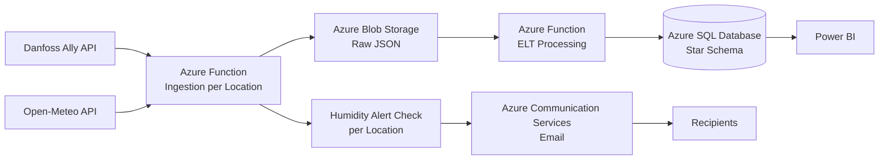

# HumidityService

An enterprise-grade .NET 10 cloud service designed for Azure. It automates the extraction, transformation, and loading (ELT) of indoor temperature and humidity telemetry from the Danfoss Ally API and outdoor meteorological data from Open-Meteo, across one or more configured locations, into an Azure SQL Database for Power BI consumption. It also sends an email alert via Azure Communication Services when the humidity in a room reaches a configurable limit.


## Architecture Overview

The system strictly follows **Clean Architecture** principles to isolate the core domain business rules from external frameworks, infrastructure, and presentation details:

* **Domain**: Contains basic domain abstractions, climate models, and validation logic. Free of external dependencies.
* **Application**: Houses the orchestration of ELT flows, data transformation mappings, and business rules.
* **Infrastructure**: Implements data persistence, external API clients, managed identity for SQL database login, and resilience retry strategies.
* **Function Host**: Entry point managing the cron configurations, dependency injection wire-ups, and configuration management.



## Tech Stack

* **Runtime:** .NET 10
* **Cloud Platform:** Azure (Functions, Blob Storage, SQL Database, Key Vault, VNet, Communication Services)
* **External APIs:** Danfoss Ally API (indoor climate), Open-Meteo API (outdoor climate)
* **Notifications:** Azure Communication Services (ACS) Email
* **Infrastructure as Code:** Terraform
* **CI/CD:** GitHub Actions
* **Database ORM:** Entity Framework Core (Star Schema Design)
* **Resilience:** Polly (Retry policies for OAuth, REST, Blob, SQL, and email sending)
* **Observability:** OpenTelemetry & Azure Application Insights
* **Testing:** xUnit & NSubstitute

## ELT Flow

1. A timer-triggered Azure Function executes hourly and iterates over all configured locations.
2. For each location, indoor climate data is retrieved from the Danfoss Ally API and outdoor climate data is retrieved from Open-Meteo. A failure for one location does not block processing of the others.
3. Raw JSON payloads are persisted to Azure Blob Storage, one blob per location per source (indoor/outdoor).
4. Right after the indoor payload is persisted, the humidity of every room with a humidity sensor is checked against its limit, and an email alert is sent for the location if any room is at or above it (see [Humidity Alerts](#humidity-alerts)).
5. Processing services transform raw payloads into dimensional models, validating incoming payloads and routing corrupt or unparseable files to a dedicated `dead-letter` container.
6. Fact and dimension records are synchronized into Azure SQL Database.
7. Power BI consumes the dimensional model for reporting.


## Humidity Alerts

Every hour, right after a location's Danfoss Ally response has been persisted, the service checks the humidity of each room that has a humidity sensor (the Danfoss Ally Room Sensors).

* **Limit:** a global default (`70` % relative humidity) applies to all rooms. A location can override it per room via `humidityThresholds` in its `Locations` entry, e.g. a higher limit for a basement where raising the temperature isn't an option.
* **When:** at most one email per location per day. The first hourly check of the day that finds a room at or above its limit sends the email; later checks that day send nothing. If a room is still above its limit the next day, a new email is sent. Nothing is sent when every room is below.
* **Room names:** per-room limits are keyed by the room's name in the Danfoss app (case-insensitive). If you rename a room there, update its key in `humidityThresholds` too.
* **Recipients:** a configurable list of email addresses.
* **Subject:** `Fugtigheds alarm fra {location}`, where `{location}` is the location's slug.
* **Body:** a table with the columns `Rum`, `Temp` and `Fugt`, one row per room with a humidity sensor. Rows for rooms at or above their limit are shown in bold red.
* **Isolation:** a failed alert is logged and never affects the persisted data or the other locations.

Configuration:

| Setting | Purpose |
|---|---|
| `HumidityAlert__DefaultThresholdPercent` | Global limit, default `70` |
| `HumidityAlert__Recipients` | JSON array of email addresses. Empty means no email is sent (the breach is still logged) |
| `HumidityAlert__SenderAddress` | Sender on the ACS email domain, shown as "Humidity service" (set by Terraform) |
| `CommunicationServices__Endpoint` | ACS endpoint, used with Managed Identity (set by Terraform) |
| `humidityThresholds` in `Locations` | Optional per-room limits, e.g. `{"Kælder":85}` |

In Azure, recipients come from the GitHub Actions variable `HUMIDITY_ALERT_RECIPIENTS` (e.g. `["you@example.com"]`) so addresses stay out of source control. The date of the last alert per location is stored as `alert-state/humidity-alert/{location}.txt`.

Example email body:

> Fugtighedsmålinger for lyngby:
>
> | Rum | Temp | Fugt |
> |---|--:|--:|
> | **Kælder** | **16,1 °C** | **81,5 %** |
> | Soveværelse | 19,8 °C | 59,7 % |
> | Stue | 21,4 °C | 58,2 % |
>
> Rum med rød fed skrift har nået deres grænseværdi.

## Data Warehouse Schema

The Azure SQL Database implements a dimensional Star Schema modeled using Entity Framework Core:
* **Fact Tables:** `FactIndoorClimateReading` and `FactOutdoorClimateReading` (Metrics: Temperature, Humidity)
* **Dimension Tables:** `DimDate`, `DimTime`, `DimLocationRoom`


## Data Integrity

The ELT process is fully idempotent.
Duplicate source payloads never create duplicate fact records.
Incoming payloads are validated against the expected schema; invalid or malformed records are logged without halting the pipeline, and corrupt or unparseable source files are routed to a dedicated `dead-letter` blob storage container.

## Getting Started

### Prerequisites
* .NET 10 SDK
* Azure CLI
* Terraform CLI
* Azurite (Local Azure Storage Emulator)

### Local Configuration
Ensure Azurite is running for local blob management. Create a `local.settings.json` file inside the `FunctionHost` project directory:

```json
{
  "IsEncrypted": false,
  "Values": {
    "AzureWebJobsStorage": "UseDevelopmentStorage=true",
    "FUNCTIONS_WORKER_RUNTIME": "dotnet-isolated",
    "DanfossApi__BaseUrl": "https://api.danfoss.com",
    "OpenMeteoApi__BaseUrl": "https://api.open-meteo.com",
    "Locations": "[{\"slug\":\"aarhus-house1\",\"danfossGatewayId\":\"<gateway-id>\",\"latitude\":56.1629,\"longitude\":10.2039,\"humidityThresholds\":{\"Kælder\":85}}]",
    "HumidityAlert__DefaultThresholdPercent": "55",
    "HumidityAlert__Recipients": "[\"you@example.com\"]",
    "HumidityAlert__SenderAddress": "humidity@<your-acs-domain>.azurecomm.net",
    "CommunicationServices__Endpoint": "https://<your-acs-resource>.communication.azure.com",
    "SqlConnectionString": "Server=localhost;Database=HumidityDwh;Trusted_Connection=True;"
  }
}
```

### Running Tests
To execute the automated unit test suite utilizing NSubstitute:
```bash
dotnet test
```

### Deploying Infrastructure
Navigate to the Terraform folder to manage environment deployments:
```bash
terraform init
terraform workspace select development
terraform apply
```

## CI/CD
1. Build
2. Unit Tests
3. Terraform Plan
4. Terraform Apply
5. EF Migration
6. Function Deployment

## Monitoring & Operations
Application logs and traces are structured via OpenTelemetry. Live monitoring dashboards, ingestion health states, ELT processing metrics, and operational alerts are available through Azure Application Insights.

## Security

* Azure Key Vault for secret management
* Zero secrets committed to source control
* VNet integration for SQL access restriction
* Azure Managed Identity authentication for Azure SQL Database and Azure Communication Services

### Local Development
For local development a SQL connection string may be used.
Production environments rely exclusively on Managed Identity authentication.

### Future Enhancements
Simple temperature control based on humidity readings
AI temperature control based on humidity readings from weather forecast and actual measurements